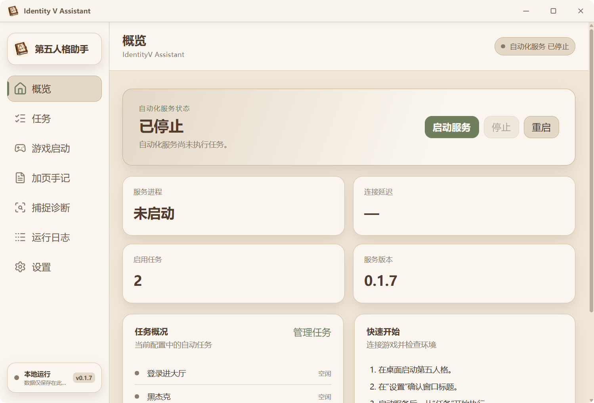
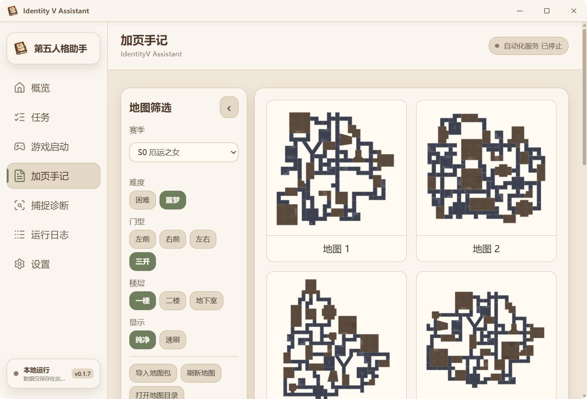

# Identity V Assistant

**语言 / Language:** 中文 | [English](README_EN.md)

Identity V Assistant 是 Windows 桌面端的《第五人格》外部视觉自动化助手。它通过窗口截图识别画面，并用普通 Windows 输入执行任务。

> 当前为 **0.1.2 开发版本**。黑杰克、自动监管者匹配、自动监管者排位和捉迷藏已通过提供的截图与逻辑检查；按约定未进行实际游戏对局验证。

## 界面预览

主界面：



加页手记（示例地图包）：



## 功能

- React + TypeScript 中英文桌面界面，默认中文
- Tauri 2 Rust 进程监督与命令桥接
- Python 常驻引擎与 NDJSON IPC
- `ready`、心跳、日志、状态、动作、指标和结构化错误事件
- 可暂停、恢复、停止的“登录进大厅”“黑杰克”“自动监管者匹配”“自动监管者排位”和“捉迷藏”任务
- Pydantic 配置校验、加载与持久化
- Windows 窗口发现、客户区、响应状态和 DPI 实时诊断
- Windows 窗口级捕捉，支持被其他窗口遮挡或放在副屏的游戏窗口
- DXcam 与 MSS 兼容回退
- OpenCV 模板匹配与可配置置信度
- RapidOCR 限定区域识别对局计时
- 状态证据、历史确认、未知状态和恢复框架
- 登录和对局任务统一使用经过前台验证的 SendInput，所有按键使用扫描码输入，失败会报错并暂停任务
- 十个固定像素识别归宿界面，八点匹配后点击书本
- “登录进大厅”任务可从任意已知登录画面继续，双帧确认后选择平台、关闭弹窗并等待归宿
- 黑杰克可从归宿、匹配、准备、对局或结算等已知阶段接管，识别角色后执行对应动作，结果页返回归宿
- 自动监管者匹配走“日记推理”；自动监管者排位走“排位模式 → 传统排位”。两者共用监管者对局逻辑，达到游戏显示时间六分钟后尝试投降
- 捉迷藏可从归宿、混沌模式、模式选择、匹配、准备、任意已知对局、淘汰或结算阶段接管；会选择“坏孩子”，并在固定状态下并行执行移动与视角循环
- 四种对局任务可分别设置无限循环；已识别的匹配、准备、淘汰和结算等待没有时限
- 窗口失去前台、丢失或截图失败时持续尝试恢复，允许手动切回；300 秒恢复超时后停止当前任务并清空队列，引擎保持运行
- 可分别禁止系统休眠和自动熄屏；自动熄屏开关也维持会话活动，减少闲置自动锁屏
- 任务卡片的“编辑”可调整登录平台、登录超时、点击延迟与随机范围、视角转动幅度及循环方式；登录设置位于“登录进大厅”任务编辑器，更改自动保存
- 同时启用多个任务时按列表顺序运行；启动任务会自动启动尚未运行的自动化服务，启用状态在重启后恢复
- 支持 F3 全局启动/停止引擎；停止会释放输入并清空当前任务队列
- 游戏窗口设置支持 2560×1440、1920×1080、1600×900、1280×720；位置可选居中、无限制、左上、右上、左下、右下，默认 1600×900 / 右上。引擎运行时自动应用并置顶；无限制保留当前位置，关闭引擎恢复原窗口。大于显示器工作区时保持所选尺寸并确保左上角可见
- 不可恢复的任务错误会暂停当前任务并保留队列，恢复时重新识别当前画面后继续；每个活动任务行都有“停止”，停止会取消当前任务并清空后续队列
- 可选内存保护：系统内存超过 90% 时清理未使用对象
- 面向普通用户开放的捕捉诊断、精简日志和窗口设置；日志支持搜索、筛选、分页和跳页
- Python 与 Rust 核心测试基础

菜单点击采用较大幅度的随机弧线，部分路线先反向移动再折返，平滑移动耗时约 0.18–0.85 秒。新配置的点击随机范围默认为 ±14 像素（原为 ±6）；已有配置值保留，可在任务编辑器调整。落点限制在目标中心附近，并按分辨率缩放安全范围；支持副屏负坐标。

## 架构

```text
React / TypeScript GUI
        |
        | Tauri commands + events
        v
Rust lifecycle supervisor
        |
        | NDJSON over stdin/stdout
        v
Python visual automation engine
        |
        v
window capture + Windows input
```

自动捕捉默认通过 Windows Graphics Capture 按游戏窗口句柄读取完整客户区。登录和对局任务均使用前台输入，在发送前重新检查窗口；键鼠按住状态由控制器追踪，释放失败会保留记录供清理重试。识别素材和参考截图分别位于 [`assets/templates/blackjack`](assets/templates/blackjack)、[`assets/templates/hunter_match`](assets/templates/hunter_match)、[`assets/templates/hunter_rank`](assets/templates/hunter_rank) 和 [`assets/templates/hide_seek`](assets/templates/hide_seek)。普通匹配与排位共用已有的监管者对局图标素材。

## 使用任务

1. 启动第五人格与本应用，确保游戏窗口已打开。
2. 在“任务”中点击对应卡片的“编辑”。“登录进大厅”编辑器包含平台、最长等待时间和点击参数；对局任务编辑器包含无限循环及共享的输入参数。
3. 勾选要运行的任务，点击“启动已启用任务”。这会在服务尚未运行时自动启动服务；多个任务按页面列表顺序执行。
4. 按 F3 启动或停止引擎。启动引擎后可从任务页启动任务；任务暂停与恢复使用任务行按钮。
5. 点击活动任务所在行的“停止”会停止该任务并清空其后队列。不可恢复的错误会保留当前任务和后续队列为暂停状态，待手动恢复。

页面左侧显示当前阶段、角色与完成循环数。默认完成一局并返回归宿后结束；“无限循环”默认关闭。任务启动和暂停恢复后会识别当前画面，从已知阶段继续。已识别的匹配、准备、淘汰和结算界面会持续等待；未知界面、持续加载或无法取得可用窗口画面仍以 300 秒为上限。捉迷藏的完整阶段与动作见 [状态机说明](docs/state-machine.md)。

监管者匹配和排位会随机移动、转动视角，使用 F、R、T、空格、Q、E 和左右键；黑杰克两种角色均包含空格、Q、E。捉迷藏确认存活对局界面后立即同时开始 WASD 和随机转动视角，目标角度为 60.1–199.9°，结合视角幅度设置换算鼠标位移；实际角度受游戏灵敏度影响。F 在移动与转视角期间每 1–3 秒重试，直到确认出现 V 图标；随后保持移动并每 5–8 秒尝试固定。若固定后 V 图标消失且仍为存活界面，WASD 循环保持运行，同时立即开始依次按 F、T、G，键间隔 0.3–0.7 秒，再每 7–13 秒按 Alt+1，直到离开对局。组合键先按住左 Alt，再按主键盘 1，依次松开 1 和 Alt。

菜单鼠标移动和视角转动采用平滑加减速；登录点击后鼠标停留在点击位置，避免瞬间跳回。

关闭引擎会先取消任务、释放输入并恢复窗口；监督层最多等待 10 秒供清理完成。普通日志显示中文任务阶段，窗口响应探测等诊断信息可通过“显示详细调试日志”查看。日志批量刷新，任务状态变化不会反复保存配置；窗口查找缓存常规探测，同时实时检查句柄、前台状态和位置。页面切换、导航指示条、卡片、任务编辑器和地图预览提供进出场动画，支持系统的减少动态效果偏好；日志列表不逐行播放动画。启动时开启引擎的设置在下次应用启动时执行一次。“关于”信息位于设置最底部；GitHub 链接通过 Windows 默认浏览器打开。

“禁止自动熄屏和闲置锁屏”在应用开启期间维持屏幕亮起，并定期发送 F15 键以刷新 Windows 闲置计时；关闭开关或退出应用即停止。手动按 Win+L 仍会锁屏，设备管理策略也可能强制锁屏。Windows 的[电源请求](https://learn.microsoft.com/en-us/windows/win32/api/winbase/nf-winbase-powersetrequest)本身只阻止屏幕因闲置熄灭；[自动锁屏策略](https://learn.microsoft.com/en-us/previous-versions/windows/it-pro/windows-10/security/threat-protection/security-policy-settings/interactive-logon-machine-inactivity-limit)按用户输入闲置时间执行。

## 本地数据

“加页手记”支持按赛季、难度、门型、楼层和纯净／速刷筛选地图，并显示全部匹配的缩略图。图片保持完整比例，地图区域随数量向下展开，通过页面滚动浏览。筛选偏好保存在 `config.json` 的 `journal` 字段；切换地图筛选不会重载游戏引擎设置。点击缩略图进入地图详情，可切换楼层和纯净／速刷显示；点击“进入地图”打开助手窗口内预览，地图等比完整显示，周边遮罩为 30% 不透明，地图区域黑底为 90% 不透明；黑底仅覆盖按原图比例缩放后的图片区域，四周保留 24px 安全边距。右上角 × 或第一次 Esc 返回详情，再按 Esc 返回列表。当前不提供自动识图或游戏悬浮地图。

“导入地图包”使用 Windows 原生文件对话框。按 Ctrl／Shift 可同时选择多个文件夹和 ZIP，点击“导入所选项目”后自动识别类型并逐个导入；单个包失败不会阻断其余包，完成后显示成功数量及失败原因。支持系统目录导航、搜索和排序。优先使用根目录的 `pack.json`；根目录没有时，自动查找嵌套目录（最多 16 层）。找到多个包会提示选择更具体的文件夹，不会任意选一个。也可将有效地图包放到下方 `journal\packs\<packId>\` 后刷新。

导入只复制描述文件引用的 PNG/JPEG/WebP 图片，不覆盖同名包，不修改源文件，不读取其他软件的安装或数据目录；暂不支持旧版 `manifest.json`。ZIP 会校验路径、链接、重复文件和解压大小。描述文件包含 `packId`、`packName`、`seasonId`、`difficulty`（`hard`/`nightmare`）和 `maps`；每张地图包含 `index`、`category`（`lf`/`rf`/`lr`/`triple`/`td`）、`floors` 和可选的 `display`。两种图片路径表按 `1`、`2`、`b1f` 楼层映射到包内相对路径，使用 `/` 分隔。`floors` 用于纯净图，`display` 用于速刷图。

配置和运行数据保存在 `%LOCALAPPDATA%\IdentityV-Assistant\`：

```text
config.json                  设置与启用任务
logs\YYYY-MM-DD.jsonl       按日期保存的完整事件
debug\captures\            手动捕捉的调试截图
journal\packs\<packId>\    加页手记地图包
```

日志文件只保留最近 30 天，启动和跨日写入时自动清理过期文件。日志页面只显示本次应用会话，最多保留 99,000 条、每页 1,000 条；清空页面不删除日期日志。详细调试开关只改变页面显示，磁盘日志仍保存完整事件。

职责边界见 [docs/architecture.md](docs/architecture.md)，协议见 [docs/ipc.md](docs/ipc.md)。

## 环境要求

- Windows 11 x86_64
- Node.js LTS
- pnpm 11+
- Rust stable（MSVC）
- Python 3.12+
- uv（推荐）
- WebView2 Runtime

## 安装依赖

```powershell
pnpm install
Set-Location engine
uv sync --extra windows --extra ocr --extra dev
Set-Location ..
```

## 运行方法

```powershell
pnpm tauri dev
```

只运行前端：

```powershell
pnpm dev
```

只运行 Python 引擎：

```powershell
Set-Location engine
uv run python main.py
```

## 一键打包安装版（Windows）

安装 Node/pnpm、Rust/MSVC Build Tools 和 uv 后，在仓库根目录双击 **`打包.bat`**。更新代码后仍用同一个文件，它会安装项目依赖、打包引擎和界面，并打开安装包输出目录；失败时保留错误信息。

也可以在仓库根目录执行：

```powershell
pnpm install --frozen-lockfile
pnpm tauri build
```

安装包位于 `src-tauri\target\release\bundle\nsis\`，获授权发布时使用 `latest.json` 指向的随机名称 `.exe`。安装时可以选择 C 盘或其他路径。安装目录中包含 UI 主程序 `identityv-assistant.exe` 和 `engine/` 引擎目录（Python、Windows 截图库、OCR 模型、识别模板和默认配置），启动时直接读取，无需每次解压。**不要单独复制 UI EXE，分发请使用安装包。**

安装向导提供中英文选择、欢迎页、专有许可、安装位置选择、安装进度和完成页，并集成开始菜单快捷方式与 Windows 卸载入口。后续安装新版时沿用标准升级流程。

用户不需要安装 Python。Microsoft Edge WebView2 Runtime 缺失时，安装程序会联网安装。配置、日志、截图和导入地图仍保存在 `%LOCALAPPDATA%\IdentityV-Assistant\`，不会混入程序安装目录或发布包。首次构建会下载依赖，因此比后续构建更慢。

构建会自动运行冻结引擎的离线检查，验证原生依赖、模板和 OCR 模型；这不代表实际游戏对局验证。`pnpm tauri dev` 保留原来的 Python 开发流程。

发行构建需要原始更新签名私钥（默认 `%LOCALAPPDATA%\IdentityV-Assistant\release-keys\updater.key`），成功后同时生成 `.sig`、`latest.json` 和 `SHA256SUMS.txt`。私钥不能上传到 GitHub，丢失后不能给既有客户端发布可信更新。完整步骤见 [更新与发布说明](docs/updates.md)。

从 v0.1.1 起，「设置 → 软件更新」支持启动时自动检查、GitHub 直连与国内代理下载、取消及重试，安装前校验发布签名、SHA-256 和文件大小。只检查不会自动安装，安装由用户确认。v0.1.0 和 v0.1.1 用户需要手动安装 v0.1.2 一次，以迁移至公开下载源。维护者提交并推送干净的 `main` 后重新打包，再运行 `scripts/publish_release.ps1 -NotesFile <版本说明文件>` 发布；打包本身不会上传。

## 验证方法

```powershell
pnpm typecheck
pnpm build

Set-Location engine
uv run pytest

Set-Location ..\src-tauri
cargo fmt --check
cargo test
```

## 项目结构

```text
frontend/       React GUI
src-tauri/      Tauri shell and Python process supervisor
engine/         Python automation engine
assets/         Template and icon registry content
config/         Default configuration
docs/           Architecture and development documentation
scripts/        Windows development helpers
engine/tests/fixtures/ Generated test images
```

## 后续计划

- 在实际游戏中校准各阶段识别与输入参数
- 在真实游戏环境中验证对局与结算识别

项目不会加入进程内挂钩、内存读取、反作弊绕过、内核输入或网络协议操作。

## 设置与更新

设置项按单行排列，布尔选项使用开关。可选择游戏 EXE、设置开机启动、最小化到托盘、界面缩放和引擎快捷键（默认 F3），并打开日志目录。保存成功后右上角提示三秒，关于信息在设置底部。

启动检查发现新版会显示版本与更新日志，可选择本次关闭或不再提示此版本。设置页提供稳定/预发布选择、GitHub/免费代理和手动检查。

## 许可证

从 v0.1.2 起，自有代码采用[专有许可](LICENSE)，仅限个人使用，禁止未经许可转载、分发或商业使用。历史版本已授予的 GPL 权利不受影响。窗口布局由本项目的独立 Win32 实现负责；第三方依赖和用户导入地图包保留各自的许可证与权利声明。
